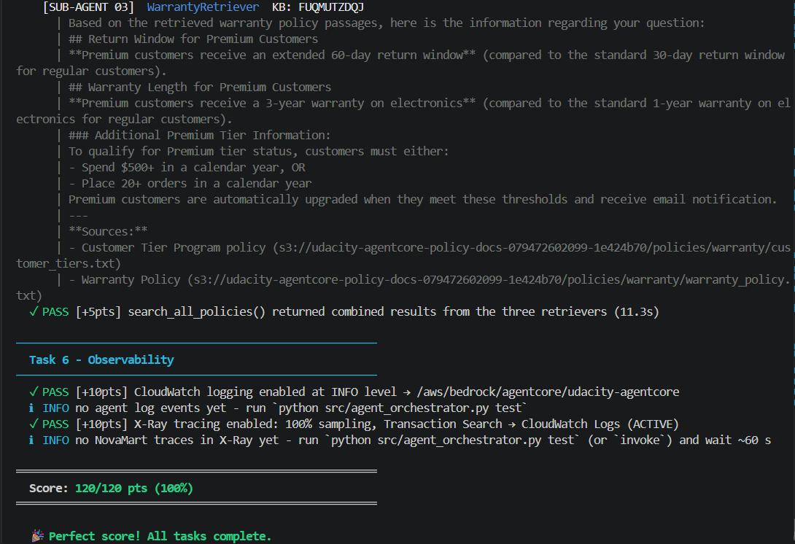

# NovaMart — Multi-Agent Customer Support System

**Udacity | Future AWS Agentic Engineer Nanodegree | Course 3, Project 3**

NovaMart is a multi-agent customer-support application implemented using the **Strands Agents SDK**, **Amazon Bedrock AgentCore**, and AWS services. It routes customer requests to specialist agents, retrieves policy information using parallel multi-agent RAG, manages order and return workflows in DynamoDB, and records execution through CloudWatch and AWS X-Ray.

This implementation builds on the Udacity Project 3 starter code. The original instructions are preserved in [`README_starter.md`](README_starter.md).

## Submission and reviewer evidence — start here

This section directly addresses the requested resubmission evidence.

| Reviewer requirement | Evidence |
|---|---|
| Completed multi-agent implementation | [`src/agent_orchestrator.py`](src/agent_orchestrator.py) |
| Populated project configuration | [`.env`](.env) (resource configuration; **must contain no credentials or other secrets**) |
| Automated tests: **120/120** | [Final score screenshot](submission/screenshots/120of120-AllTestsPassed-p6.png) and [all six parts](#automated-test-results-120120) |
| Deployed AgentCore Runtime | [AgentCore Runtime screenshot](submission/screenshots/aws_agentcore_runtime.png) |
| Returns, Shipping, Warranty Knowledge Bases | [KB deployment evidence](#aws-knowledge-base-deployment-evidence) (nine screenshots) |
| Live execution: `python src/agent_orchestrator.py test` | [Local execution evidence](#local-end-to-end-test-command) (15 screenshots) |
| Distributed tracing | [AWS X-Ray Service Map](submission/screenshots/xray_service_map.png) |

**Important distinction:** The automated scoring command, `python tests/test_agent.py all`, and the end-to-end execution command, `python src/agent_orchestrator.py test`, are **different tests**. Evidence for both is provided below. The local test command exercises AWS-backed tools, while the separate `invoke` command calls the deployed AgentCore Runtime.

## Architecture

```text
Customer request
      |
      v
OrchestratorAgent (Claude Haiku 4.5)
      |
      +-- InventoryAgent (Claude Sonnet 4.5)
      |      +-- DynamoDB: customer and order records
      |
      +-- PolicyAgent (Claude Sonnet 4.5)
      |      +-- ReturnsPolicyRetriever  -> Returns Knowledge Base
      |      +-- ShippingPolicyRetriever -> Shipping Knowledge Base
      |      +-- WarrantyPolicyRetriever -> Warranty Knowledge Base
      |          (parallel retrieval with ThreadPoolExecutor)
      |
      +-- RefundAgent (Claude Sonnet 4.5)
      |      +-- Return eligibility and conditional initiation
      |
      +-- CommunicationAgent (Claude Sonnet 4.5)
             +-- Final customer-facing response

Shared workflow state: DynamoDB WorkflowStateTable
Observability: Amazon CloudWatch Logs + AWS X-Ray
```

The Orchestrator initializes each session and uses the following routing rules:

- **Return/refund requests:** InventoryAgent → RefundAgent → CommunicationAgent.
- **Policy questions:** PolicyAgent → three parallel Knowledge Base retrievers → CommunicationAgent.
- **Calculations:** CommunicationAgent.
- **All requests:** CommunicationAgent prepares the final response.

The AWS X-Ray Service Map visualizes service dependencies; the detailed span timeline shows the nested policy-retrieval calls. A direct line between the main application and a Knowledge Base on the Service Map does not mean PolicyAgent was bypassed.

## Implemented features

- Five Strands agents: Orchestrator, Inventory, Policy, Refund, and Communication.
- Three specialist policy retriever sub-agents, coordinated in parallel using `ThreadPoolExecutor` and `as_completed()`.
- Bedrock Knowledge Bases backed by **Amazon S3 Vectors** for Returns, Shipping, and Warranty.
- Customer/order lookups and shared, versioned workflow state in DynamoDB.
- Return decision logic for Standard (30 days) and Premium (60 days) tiers, including duplicate-return protection and conditional DynamoDB updates.
- Bedrock Guardrails, AgentCore Memory with a session-summary strategy, CloudWatch logging, and X-Ray tracing.
- Deployment to Amazon Bedrock AgentCore Runtime in **`us-east-1`**.

**Scope:** The optional AgentCore Gateway/MCP extension was not implemented; it is outside the required Project 3 rubric.

## Technology stack

Python 3.12 (local development), Strands Agents SDK, Claude Haiku 4.5 (Orchestrator), Claude Sonnet 4.5 (workers), Amazon Bedrock AgentCore, Bedrock Knowledge Bases, Titan Text Embeddings v2, Amazon S3 Vectors, DynamoDB, S3, CloudFormation, CloudWatch, and AWS X-Ray.

## Verification and test results

### Automated test results — 120/120

The provided automated verification suite passed with **120/120 points (100%)**:

```bash
python tests/test_agent.py all
```

The complete console output is retained in six screenshots:

[Part 1](submission/screenshots/120of120-AllTestsPassed-p1.png) · [Part 2](submission/screenshots/120of120-AllTestsPassed-p2.png) · [Part 3](submission/screenshots/120of120-AllTestsPassed-p3.png) · [Part 4](submission/screenshots/120of120-AllTestsPassed-p4.png) · [Part 5](submission/screenshots/120of120-AllTestsPassed-p5.png) · [Part 6 — final score](submission/screenshots/120of120-AllTestsPassed-p6.png)



### AWS Knowledge Base deployment evidence

Three Knowledge Bases were created and synced in **`us-east-1`**. They use **Titan Text Embeddings v2** (`amazon.titan-embed-text-v2:0`) and Amazon S3 Vectors, with a separate vector index for each policy domain. Their S3 policy documents are organized under the corresponding `policies/` prefixes.

| Knowledge Base | KB ID | S3 policy prefix | S3 Vectors index |
|---|---|---|---|
| Returns | `NUQSM9FYKL` | `policies/returns/` | `returns-policy-index` |
| Shipping | `JSCPPPDYDE` | `policies/shipping/` | `shipping-policy-index` |
| Warranty | `FUQMUTZDQJ` | `policies/warranty/` | `warranty-policy-index` |

**AWS Console screenshots** (overview/availability, embedding model + S3 Vectors configuration, and completed data-source synchronization):

| Knowledge Base | Overview | Vector store and index | Data-source sync |
|---|---|---|---|
| **Returns** | [Overview](submission/screenshots/aws_kb_returns_overview.png) | [S3 Vectors configuration](submission/screenshots/aws_kb_returns_vector_store.png) | [Sync evidence](submission/screenshots/aws_kb_returns_sync.png) |
| **Shipping** | [Overview](submission/screenshots/aws_kb_shipping_overview.png) | [S3 Vectors configuration](submission/screenshots/aws_kb_shipping_vector_store.png) | [Sync evidence](submission/screenshots/aws_kb_shipping_sync.png) |
| **Warranty** | [Overview](submission/screenshots/aws_kb_warranty_overview.png) | [S3 Vectors configuration](submission/screenshots/aws_kb_warranty_vector_store.png) | [Sync evidence](submission/screenshots/aws_kb_warranty_sync.png) |

The parallel-policy test also returned source passages from all three configured Knowledge Bases (see local test evidence below).

### AgentCore Runtime deployment evidence

The deployed Runtime is **`udacity_agentcore_runtime-EY9eLjCnzN`** in **`us-east-1`**. The Runtime details screenshot documents its deployment/status in the AWS Console:

[View AgentCore Runtime deployment screenshot](submission/screenshots/aws_agentcore_runtime.png)

The deployed application was also invoked successfully using `python src/agent_orchestrator.py invoke` (separate from the local `test` command), as evidenced by the response screenshots linked below.

### Local end-to-end test command

At the reviewer's request, the following command was executed:

```bash
python src/agent_orchestrator.py test
```

It built the local five-agent graph, executed all three predefined scenarios sequentially using AWS-backed services, and published X-Ray traces. **The execution completed without an unhandled error.** Screenshots of the command output are grouped below in the order of execution.

| Scenario | Observed behavior | Execution screenshots |
|---|---|---|
| **1. Return request (`CUST-001`, `ORD-27176`)** | InventoryAgent → RefundAgent → CommunicationAgent. The existing return was recognized; no duplicate was initiated. | [Part 1](submission/screenshots/local_test_return_p1.png) · [Part 2](submission/screenshots/local_test_return_p2.png) · [Part 3](submission/screenshots/local_test_return_p3.png) · [Part 4](submission/screenshots/local_test_return_p4.png) |
| **2. Premium policy question (`CUST-002`)** | PolicyAgent called `search_all_policies`; three retrievers executed in parallel. Output confirmed **“All 3 KBs responded”**; CommunicationAgent composed the answer. | [Part 1](submission/screenshots/local_test_policy_p1.png) · [Part 2](submission/screenshots/local_test_policy_p2.png) · [Part 3](submission/screenshots/local_test_policy_p3.png) · [Part 4](submission/screenshots/local_test_policy_p4.png) · [Part 5](submission/screenshots/local_test_policy_p5.png) · [Part 6](submission/screenshots/local_test_policy_p6.png) · [Part 7](submission/screenshots/local_test_policy_p7.png) · [Part 8](submission/screenshots/local_test_policy_p8.png) · [Part 9](submission/screenshots/local_test_policy_p9.png) |
| **3. Discount calculation (`CUST-003`)** | CommunicationAgent calculated **$134.96** for five items at $29.99 each with a 10% discount. | [Part 1](submission/screenshots/local_test_calculation_p1.png) · [Part 2](submission/screenshots/local_test_calculation_p2.png) |

**Parallel output note:** Some text from the three policy retrievers overlaps in the live terminal stream because the retrievers execute concurrently. The subsequent per-retriever summaries are readable and show the results from all three Knowledge Bases.

#### Return workflow verification — initial initiation and duplicate prevention

Two distinct executions explain why the local test displays an **existing** return reference:

1. **Initial return initiation via the deployed AgentCore Runtime:** A request for order `ORD-27176` (customer `CUST-001`) followed **InventoryAgent → RefundAgent → CommunicationAgent**. The return was successfully initiated with reference **`RET-EB442DA80C`**. A subsequent DynamoDB read confirmed the order status changed from `delivered` to `return_initiated`. Evidence: [initial response](submission/screenshots/return_initiated.png) and [DynamoDB record](submission/screenshots/dynamodb_return_update.png).
2. **Later run of `python src/agent_orchestrator.py test`:** The built-in test uses the **same seeded order**, which was already in `return_initiated` status. RefundAgent retrieved the stored return reference and **correctly did not initiate a second return**. This demonstrates duplicate-return prevention rather than a failed return attempt. Evidence: [local return test, parts 1–4](submission/screenshots/local_test_return_p1.png).

**Scope of the transaction:** A return request was initiated and recorded; **no payment refund was disbursed** by these tests.

### Other deployed Runtime evidence

These screenshots were captured during individual invocations of the deployed AgentCore Runtime:

- [Premium return-policy response](submission/screenshots/premium_return_policy.png)
- [Discount calculation response](submission/screenshots/discount_calculation.png)
- [Initial return-initiation response](submission/screenshots/return_initiated.png)
- [DynamoDB return status after initiation](submission/screenshots/dynamodb_return_update.png)

### AWS X-Ray tracing

[View X-Ray Service Map](submission/screenshots/xray_service_map.png)

The traced policy request showed the Orchestrator, PolicyAgent, three Knowledge Base retrieval operations, and CommunicationAgent. The local execution also reported successful X-Ray trace publication for each of its three scenarios. The Service Map displays dependencies, while the span timeline provides the call hierarchy.

## Running the project

The solution requires the corresponding AWS resources and access permissions in **`us-east-1`**. Deployment used temporary credentials provided by the Udacity lab; these must be configured **outside this public repository**.

```bash
python -m pip install -r requirements.txt
```

For a fresh environment, populate `.env` from `.env.example` with the appropriate resource identifiers and non-secret configuration, following [`README_starter.md`](README_starter.md). Do not overwrite an existing populated `.env` unintentionally.

Run automated verification:

```bash
python tests/test_agent.py all
```

Run the local end-to-end scenarios (uses AWS resources and may change seeded order state):

```bash
python src/agent_orchestrator.py test
```

Invoke the deployed Runtime with a policy question:

```bash
python src/agent_orchestrator.py invoke \
  'What is the return policy for premium customers?' \
  CUST-001
```

**Caution:** The local test's return scenario refers to `ORD-27176`, which is already `return_initiated` in the tested environment. Do not reset or alter the order merely to make the output show a second initiation. Verify order state before running transactional scenarios again.

## Main project files

- [`src/agent_orchestrator.py`](src/agent_orchestrator.py) — implemented agent builders, tools, routing, runtime entry point, memory, and observability setup.
- [`src/bedrock_kb_retrieval.py`](src/bedrock_kb_retrieval.py) — starter Knowledge Base retrieval helper.
- [`src/agent_observability.py`](src/agent_observability.py) — starter X-Ray/CloudWatch instrumentation.
- [`config.py`](config.py) — AWS configuration loader.
- [`infrastructure/`](infrastructure/) — supplied CloudFormation, seeding, and cleanup scripts.
- [`tests/test_agent.py`](tests/test_agent.py) — supplied automated test suite.
- [`submission/screenshots/`](submission/screenshots/) — test and AWS Console evidence.
- [`README_starter.md`](README_starter.md) — original Udacity instructions.

## Outcome and limitations

The project implements and demonstrates multi-agent routing, parallel policy retrieval, DynamoDB-backed workflow management, AgentCore Runtime deployment, and CloudWatch/X-Ray observability. The supplied automated checks passed **120/120**, and both deployed-Runtime invocation and local end-to-end execution were exercised.

The built-in policy test asks about **Premium** benefits while using seeded customer `CUST-002` (**Standard**). The retrieved Premium policy terms are correct, but the communication response addresses the customer as Premium; this personalization should be improved in a future iteration. This does not affect the confirmation that all three KB retrievers responded.

**Security:** The project submission includes a populated `.env` as requested by the Udacity submission instructions. Because this repository is public, `.env` must contain **only non-secret resource configuration**. Never commit AWS access keys, secret access keys, session tokens, passwords, or other credentials. If a secret has ever been committed, removing it from a later commit alone does not erase it from Git history.
